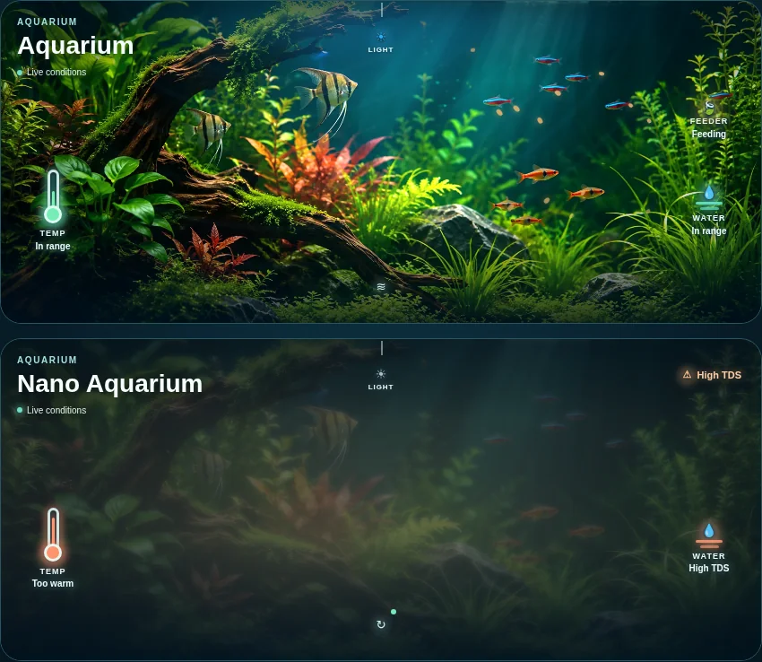

# HA Aquarium Card 🐠

A modern, photo-first, **multi-aquarium** Lovelace card for Home Assistant, with automatic discovery and native clickable entity details.



## Overview

- **Your aquarium is the hero.** A colorful bundled aquarium photograph is shown immediately; swap it for your own tank photo with a local image URL.
- **Zero-config discovery.** Find aquarium equipment through matching Home Assistant area names, area labels, device labels and entity labels. The default matching word is `Aquarium` (editable).
- **Multiple tanks.** Show each aquarium area separately, split tanks using distinct labels (such as `Aquarium Main` and `Aquarium Nano`), or manually define tanks in the visual editor.
- **No overcrowding.** Displays up to five important readings by default, selecting from water temperature, TDS, current light color/effect, feeder status/last feed, water level, pH, salinity, pump and heater. Unavailable readings never display as valid measurements.
- **Meaningful attention.** Explicit device problem/alarm entities such as high TDS or leaks show an alert; the card does **not** infer arbitrary safety thresholds.
- **Click to investigate.** Every reading and alert opens the corresponding native HA more-info dialog; nothing toggles pumps, changes lights or feeds fish just because the user tapped a status.
- **HA visual editor.** Configure matching text, metrics shown, image, and multiple individual tanks without editing YAML; entity overrides remain available in YAML.
- **Lightweight.** No frontend dependencies, no backend service, no credentials, and no external requests for the default photograph.

<!-- ha-marketplace:exclude-start -->
## Install

1. **Home Assistant 2026.11+**: Settings → Marketplace → Custom repositories → add `https://github.com/Chreece/Ha-Aquarium-Card` as **Dashboard**, then install. On older Home Assistant use HACS → Custom repositories → **Dashboard**.
2. Reload the Home Assistant browser tab after installation.
3. Add **Aquarium Card** from the dashboard card picker.

The Marketplace/HACS installs `dist/ha-aquarium-card.js` and the bundled photo into `www/community/Ha-Aquarium-Card/`. On a dashboard that uses YAML resources, add `/local/community/Ha-Aquarium-Card/ha-aquarium-card.js` as a JavaScript module yourself.

**Note:** Custom-repository installation is separate from listing in the public Marketplace search catalog. The public catalog requires acceptance of a submission to `hacs/default`.
<!-- ha-marketplace:exclude-end -->

## Configuration

### Automatic discovery

Just add the card. It uses the word `Aquarium` to discover and group supported entities using HA areas and labels.

```yaml
type: custom:ha-aquarium-card
match: Aquarium
max_metrics: 5
image: /local/aquariums/default.jpg # optional; otherwise use the bundled image
```

The image can be changed from the visual editor. For example, `config/www/aquariums/default.jpg` becomes `/local/aquariums/default.jpg`. HTTPS images are also supported.

### Multiple aquariums

In the card editor, select **Add aquarium** and configure a tank name, area, optional label, and image. Two tanks in the *same* area should have different labels assigned to their relevant devices/entities.

```yaml
type: custom:ha-aquarium-card
match: Aquarium
max_metrics: 5
aquariums:
  - name: Planted aquarium
    area: wohnzimmer
    label: aquarium_planted
    image: /local/aquariums/planted.jpg
    entities:
      light: light.aquarium_wled
      temperature: sensor.aquarium_multisensor_temperature
      tds: sensor.aquarium_multisensor_tds
      feeder: datetime.fishfeeder_last_feed
  - name: Shrimp aquarium
    area: arbeitszimmer
    label: aquarium_shrimp
    image: /local/aquariums/shrimp.jpg
```

`area` can be an area name or ID; `label` can be a label name or ID. If both are set, the card only considers entities matching both criteria, except the explicitly configured metric overrides. Entity override keys are `temperature`, `tds`, `light`, `feeder`, `water_level`, `ph`, `salinity`, `pump`, `heater`, and `leak`.

The card prioritizes sensor/device characteristics and water-related names, rather than hard-coding specific vendors. For example it recognises `sensor.aquarium_multisensor_temperature`, `binary_sensor.aquarium_multisensor_high_tds`, `datetime.fishfeeder_last_feed`, aquarium WLED lights, and numeric TDS/PPM sensors.

## Compatibility and limitations

- Prepared for HA **2026.11 Marketplace** dashboard resources, and HACS-style installs. Tested with automated local mocks; a live HA instance is not part of the test environment.
- Labels are resolved with the Home Assistant label registry, with fallback to label IDs if a user cannot access the registry. Area/device/entity registries are provided by HA's frontend.
- Distinct area names/labels identify tanks automatically. If two aquariums have the same label *and* live in the same area, give them distinct labels or define each tank manually.
- Sensors without recognizable metadata may require an `entities:` override.
- Home Assistant must supply an explicit binary alarm/problem state for warning indicators. The card does not prescribe aquarium water-quality ranges.

## Developer notes

`dist/ha-aquarium-card.js` is the **ready-to-install** ES module; `dist/aquarium-default.webp` ships beside it. No build step is needed. Run `npm test` (Node 22+) to exercise detection and state presentation, and `npm run check` for syntax validation. The included GitHub Action also checks Marketplace/HACS `plugin` metadata.

## License

MIT.
